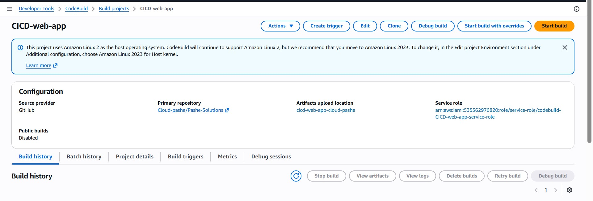

# Automated CI/CD Web Application Deployment Pipeline

## Goal: Automate the build, packaging, storage, and deployment of a web application on AWS.

**Core Components:**
- GitHub / GitHub Codespaces for source code management.
- AWS CodeBuild for automated build processing and artifact packaging.
- Amazon S3 for centralized storage of build artifacts.
- AWS CLI for retrieving application artifacts from S3.
- Linux EC2 instance for hosting the web application.
- Bash scripts for dependency installation and deployment.
- Apache2 web server for serving the application.

### Note:
The `buildspec.yml` file defines the build process and specifies the application files to be packaged by AWS CodeBuild. The generated artifacts are stored in Amazon S3 and retrieved using the AWS CLI on the target server. Bash scripts handle dependency installation and application deployment, reducing manual file handling and making the process repeatable.

# RESULTS & EXPLANATION

### Automated CI/CD Pipeline Architecture

The workflow connects GitHub, AWS CodeBuild, Amazon S3, and the target Linux server. CodeBuild processes the application files according to the `buildspec.yml` configuration and packages the required deployment artifacts. Amazon S3 serves as the centralized repository from which the target server retrieves the application files.

### AWS Codebuild

AWS CodeBuild reads the instructions inside the buildspec.yml file during the build and post-build phases, packages the designated application files (such as index.html, appspec.yml, and the scripts folder), and automatically uploads the compiled artifact zip directly to the designated Amazon S3 bucket for secure storage.

### Amazon S3: Artifact Storage

Amazon S3 stores the packaged application artifacts, making them available for retrieval during deployment. The AWS CLI is used to inspect the bucket contents and synchronize the required files to the target server.

### AWS CLI (Bash Scripts): Artifact Retrieval, Server Provisioning and Deployment

Bash scripts handle the installation of required dependencies and preparation of the Apache web server. After retrieving the artifacts, the deployment commands copy the custom `index.html` file into Apache's document root at `/var/www/html/`.

This approach makes server setup and application deployment more consistent and repeatable.

### Connecting to the Web Application (Result)

The deployment was verified by accessing the web application over HTTP on port 80. The Apache web server successfully served the custom application page displaying **Automated Deployment Pipeline - v1.0**.

### Project Outcome

The project demonstrates how AWS CodeBuild, Amazon S3, AWS CLI, Linux, and Bash can work together to establish a repeatable application build and deployment workflow.

The build and artifact-storage stages are automated through AWS CodeBuild and Amazon S3, while deployment is performed using AWS CLI commands and shell scripts on the target server. This project provides a foundation for implementing fully automated deployments using AWS CodePipeline, AWS Systems Manager, or AWS CodeDeploy.